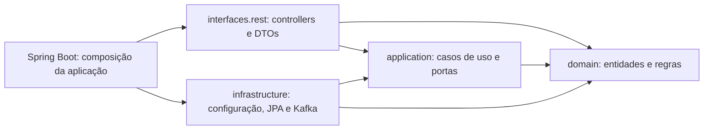
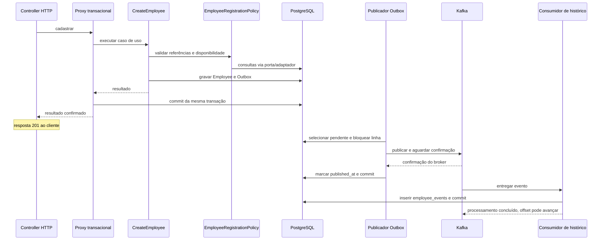

# Arquitetura da solução

Estado consolidado em 28/10/2026, após integração dos PRs #1 a #12. Este documento descreve o código existente; as [ADRs](decisions/README.md) preservam alternativas e evidências de cada etapa.

## Contexto e limites

Uma aplicação Spring Boot atende Gestão de Pessoas. Employee, Department e Position são raízes de agregados distintos, com referências por UUID. Cada agregado contém uma entidade no escopo atual; não há necessidade demonstrada de carregar uma coleção de colaboradores junto a Department.

O domínio tem dados válidos por construção e comportamento de inativação. EmployeeRegistrationPolicy decide as condições de admissão que envolvem outros registros. HTTP, banco e transporte de eventos são detalhes externos ao núcleo. Essa separação aplica princípios de Clean/Hexagonal Architecture sem dividir o projeto em múltiplos serviços ou módulos Maven.

## Dependências do código

As setas abaixo indicam dependências de código, não a ordem das chamadas:

| Camada | Classes representativas | Responsabilidade |
|---|---|---|
| domain | Employee, Email, Department, Position, EmployeeRegistrationPolicy | Identidade, valores, transição de estado e condições de admissão |
| application | CreateEmployee, DeactivateEmployee, ListEmployees, EmployeeRepository, EmployeeEventOutbox | Coordenar operações por portas próprias, sem Spring |
| infrastructure | ApplicationConfig, TransactionalEmployeeRegistration, EmployeePersistenceAdapter, JpaEmployeeEventOutbox, consumidores | Compor objetos, delimitar transações e implementar acesso a banco/transporte |
| interfaces | EmployeeController, OrganizationController, EmployeeExceptionHandler | Contrato HTTP, validação de entrada, DTOs e tradução de erros |

Domínio e aplicação compilam com JDK 21 sem classpath externo. As portas de repositório e Outbox pertencem à aplicação; EmployeeRegistrationRequirements pertence ao domínio porque fornece os fatos consumidos pela política. A composição Spring injeta implementações das camadas externas. A interface HTTP não usa repositórios Spring Data diretamente.

Não foi criada uma abstração para cada classe técnica: OutboxPublishingTransaction depende de KafkaOutboxDelivery dentro da infraestrutura. O desacoplamento do núcleo ocorre pela porta EmployeeEventOutbox; uma futura troca do transporte exige adaptar a infraestrutura, os contratos e a operação.

## Modelo e responsabilidades

Employee tem identidade por ID, criação ACTIVE e `deactivate()`, que retorna false se já estiver INACTIVE. `restore()` reconstitui o estado persistido sem tratar a leitura como nova contratação. Department e Position também usam igualdade/hashCode por ID e possuem atributos imutáveis.

Email e CostCenterCode são objetos de valor. Email normaliza espaços externos e caixa; o formato é uma política ASCII simplificada. Normalização não garante unicidade: a política consulta disponibilidade, enquanto a constraint única no banco resolve disputas concorrentes. Chaves estrangeiras protegem departamento e cargo existentes.

As entidades JPA são separadas das entidades do domínio. Essa duplicação exige mapeamento, mas evita anotações de persistência e lazy loading no núcleo. Versão otimista é metadado de persistência transportado por VersionedEmployee, separado da identidade do agregado. EmployeePagination e PageResult mantêm Spring Data apenas no adaptador.

UUID evita coordenação de um gerador numérico central; seu custo é ergonomia humana e tamanho de chave/índice. Os filtros por nome/departamento atendem a navegação prevista; não foi introduzido outro identificador de negócio.

## Cadastro e evento

O diagrama representa o fluxo de cadastro. O proxy transacional confirma o banco antes de devolver sucesso ao controller; o ramo de publicação é posterior e assíncrono.

O desenho não implica ordem entre a marcação da Outbox e a gravação do histórico: o consumidor pode processar assim que Kafka disponibiliza a mensagem. Em falha do cadastro, Employee e intenção de evento sofrem rollback juntos. `saveAndFlush()` antecipa a execução SQL e possíveis violações, mas não substitui o commit.

## Inativação e concorrência

EmployeeDeactivationCoordinator chama TransactionalEmployeeDeactivation, que abre REQUIRES_NEW, lê Employee com sua versão, aplica a transição e grava a mudança/evento. JPA usa `@Version` para rejeitar uma atualização com versão antiga. Isso é controle otimista; não mantém um bloqueio exclusivo desde a leitura.

Em conflito, a transação termina com rollback e o coordenador permite uma releitura em nova transação. Se o registro já está inativo, retorna 204 sem outro evento lógico; um segundo conflito retorna 409. O proxy Spring está em outro bean para que a nova chamada seja interceptada. Não há tentativa de reutilizar uma transação abortada.

## Contratos e entrega assíncrona

| Contrato JSON | Destino | Conteúdo |
|---|---|---|
| EmployeeCreatedEvent, schemaVersion 1 | employee-created.v1 | eventId, employeeId, occurredAt, eventType, schemaVersion |
| EmployeeStatusChangedEvent, schemaVersion 1 | employee-status-changed.v1 | Metadados acima, previousStatus e newStatus |

A chave Kafka é employeeId; eventId identifica a ocorrência lógica e permanece igual nos reenvios. Dois tópicos preservam o contrato de criação, mas não garantem ordem global nem entre eventos de um colaborador em tópicos distintos. Retry de publicação também pode alterar a ordem observada. `createdAt` não é reutilizado como instante de inativação.

O poller busca até 20 IDs disponíveis. Cada tentativa usa sua própria transação e bloqueio pessimista da linha da Outbox; mantém conexão/bloqueio enquanto aguarda Kafka. Confirmação do broker precede a marcação no banco. Se o envio aconteceu e a marcação/commit falha, a mensagem poderá ser reenviada com o mesmo eventId.

EmployeeHistoryWriter usa JPA com REQUIRES_NEW e `saveAndFlush()`. A PK event_id impede histórico duplicado. O handler trata integridade após o rollback do writer e confirma que aquele ID existe antes de reconhecer a duplicata. UUID atribuído nas entidades de evento usa Persistable para indicar INSERT, evitando que um merge atualize um registro que deveria ser imutável.

O consumidor usa ack-mode RECORD e auto-commit desabilitado. Uma falha de persistência é propagada para retry; o processamento bem-sucedido ou a duplicata reconhecida permite avançar o offset. O histórico é um registro de fatos, não event sourcing nem uma projeção usada para modificar Employee.

## Persistência, execução e testes

Flyway V1 cria departamentos/cargos; V2 cria colaboradores e constraints; V3 acrescenta versão; V4 cria Outbox e histórico. JPA valida o schema, sem recriá-lo automaticamente. Todo acesso de persistência da aplicação usa JPA; JdbcTemplate aparece apenas em fixtures e verificações de teste.

O Compose executa aplicação/PostgreSQL/Kafka, com volumes e listeners internos/externos. Testcontainers gerencia serviços separados para testes, sem depender dos volumes do Compose. Spring Boot gerencia os beans de container e suas conexões; o perfil Maven testcontainers ativa o modo completo. O cache de contextos compartilha alguns bancos entre classes, portanto fixtures ainda precisam de limpeza.

Unitários verificam regras e coordenação; integração verifica HTTP, migrations, constraints, rollback, concorrência e publicação/consumo Kafka. Os testes controlados desabilitam o agendamento e chamam o publicador explicitamente; o smoke de Docker validou o agendamento real. Nenhum deles prova todos os modos de falha de uma implantação distribuída.

## Limites e evoluções possíveis

| Limite atual | Consequência e evolução possível |
|---|---|
| Uma instância de publicador validada; lock/conexão durante envio | Broker lento ocupa conexões; avaliar reserva com lease/SKIP LOCKED ou CDC conforme volume |
| Retry infinito no consumidor, sem DLQ | Mensagem inválida pode bloquear a partição; avaliar classificação de falhas, DLQ e procedimento de reprocessamento |
| Sem limpeza de Outbox/histórico | Dados crescem; definir retenção, arquivamento e monitoramento |
| Uma partição/réplica por tópico no ambiente local | Sem validação de alta disponibilidade; dimensionar broker, partições e retenção para uso real |
| Paginação por offset e count | Custo em grandes volumes e deslocamento de páginas entre mudanças; avaliar cursor quando houver requisito |
| LIKE parcial e comparação lower | Consultas podem precisar de índices/plano específico; desempenho e acentuação não foram validados por carga |
| Dois formatos de erro HTTP | Cliente precisa tratar ambos; padronização seria alteração de contrato própria |
| Sem autenticação e sem versão na URI/header | Não foram exigidos nos endpoints obrigatórios; planejar antes de expor um produto real |
| Logs customizados em texto com campos e Actuator health | Não há configuração JSON de logs, tracing distribuído ou métricas específicas de atraso da Outbox |

As alternativas acima são possibilidades de evolução, não funcionalidades entregues nem decisões novas aprovadas. A ausência de ordem/exactly-once é assumida pelo contrato e pelo histórico idempotente. Requisitos de produção, carga e recuperação precisam de validação própria.
