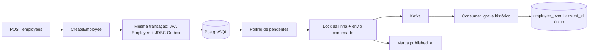

# 006 — Cadastro com Outbox e Kafka

Estado: Outbox aprovada pelo responsável técnico; implementação em feature/employee-created-outbox aguardando revisão. Data: 27/10/2026.

## Problema, alternativas e decisão

Publicar após o commit com ApplicationEventPublisher e @TransactionalEventListener(AFTER_COMMIT) permite confirmar o cadastro e perder o evento se o processo parar antes do envio. Publicar antes do commit pode produzir um evento de uma operação posteriormente desfeita. Kafka transactions, isoladamente, não tornam a transação PostgreSQL atômica com o broker.

Após discutir complexidade e garantias, o responsável técnico solicitou Outbox. O primeiro incremento cobre apenas EmployeeCreatedEvent: empregado e intenção de publicação são gravados na mesma transação; um publicador periódico envia ao Kafka; o consumidor grava o histórico. EmployeeStatusChangedEvent permanece pendente.

A alternativa CDC/Debezium reduz a necessidade de polling, mas adiciona infraestrutura e operação. Reservas com lease/SKIP LOCKED e envio fora da transação melhoram o uso das conexões, mas acrescentam recuperação de reservas e controle de concorrência. Foram adiados para manter este incremento compreensível e adequado ao volume do desafio.

## Fluxo e fronteiras

CreateEmployee registra o fato depois de salvar o empregado; o Spring coordena a transação em TransactionalEmployeeRegistration. O domínio só conhece um record imutável EmployeeCreatedEvent. A aplicação usa EmployeeEventOutbox; não conhece Kafka, JSON ou tabelas da Outbox.

JdbcEmployeeEventOutbox usa MANDATORY, em um bean separado interceptado pelo proxy Spring. Uma chamada sem transação falha. JpaTransactionManager e JdbcTemplate compartilham a conexão do mesmo DataSource; um erro desfaz empregado e Outbox. A migração V4 cria Outbox e histórico. JDBC foi escolhido para SQL explícito de polling e inserção do histórico; a persistência dos agregados continua em JPA.

## Publicação

OutboxPoller, acionado por @Scheduled com fixedDelay de um segundo, seleciona até 20 identificadores disponíveis. Cada chamada ao bean OutboxPublishingTransaction usa REQUIRES_NEW: relê e bloqueia a linha com FOR UPDATE, revalida que está pendente/disponível, envia, aguarda confirmação e marca published_at.

O envio usa KafkaTemplate com chave employeeId, valores JSON em String e acks=all. O producer tem idempotência habilitada; isso não deduplica reenvios feitos pela Outbox após reinício. max.block.ms=5000 limita a espera por metadados/buffer; delivery.timeout.ms=10000 e get de até 15 segundos limitam o envio. Esses limites não representam um SLA total da transação ou de indisponibilidade.

Falha de envio mantém o evento pendente, incrementa attempts, registra apenas o tipo do erro em last_error e adia a próxima tentativa por cinco segundos. A falha de um evento não impede que os demais selecionados sejam tentados. Falhas de banco na marcação propagam e provocam rollback; o próximo ciclo poderá reenviar. attempts conta tentativas confirmadas na transação local, não todo envio que possa ter ocorrido antes de uma falha.

Este desenho mantém uma conexão e um lock durante a espera pelo Kafka. Isso reduz throughput e pode causar contenção. Foi validado com um publicador. A revalidação protege a linha, mas não substitui validação de múltiplas instâncias nem oferece ordenação global. Retries com available_at podem reordenar eventos.

## Contrato e consumo

EmployeeCreatedMessage explicita schemaVersion=1, eventType=EmployeeCreatedEvent, eventId, employeeId e occurredAt. O payload não contém nome ou e-mail. O tipo não depende de headers de classes Java; a desserialização usa um contrato conhecido e valida versão, tipo, campos obrigatórios e correspondência entre chave Kafka e employeeId.

EmployeeCreatedKafkaConsumer chama EmployeeHistoryWriter, em outro bean com transação própria REQUIRES_NEW. O histórico usa event_id como chave primária e armazena tipo, empregado, instante de ocorrência, processamento e payload. Não possui FK para Employee: histórico e consumo não dependem da existência atual do agregado.

Duplicatas falham na inserção protegida pela chave e são reconhecidas fora da transação que sofreu rollback. Não se captura a exceção dentro de uma transação abortada para tentar confirmá-la. O único índice único dessa tabela é event_id; ele identifica a mensagem lógica, preservada nos reenvios.

O consumer tem enable-auto-commit=false e AckMode.RECORD. Somente após o método retornar com sucesso o container pode confirmar o offset. Erros de processamento são repetidos com intervalo de um segundo e sem descarte automático. Uma mensagem inválida bloqueia sua partição: DLQ, alertas e intervenção operacional continuam pendentes. A falha transitória em testes é injetada antes do insert; não se afirma que todos os tipos de falhas de banco foram simulados.

## Garantias e limites

- Falha antes do commit: empregado e evento são desfeitos.
- Commit com broker indisponível: a intenção permanece no PostgreSQL e pode ser reenviada quando o serviço voltar.
- Broker confirma, mas a marcação falha: o mesmo evento pode ser enviado novamente.
- Histórico confirma, mas o offset não: o Kafka pode entregar novamente; event_id impede outro registro.
- A resposta 201 confirma cadastro e intenção, não publicação/consumo.
- Não há transação distribuída nem promessa de exactly-once. A entrega depende de recuperação dos serviços, persistência dos bancos/volumes e retenção do Kafka.
- O tópico local tem uma partição e uma réplica. Não oferece tolerância à perda do único broker/volume.
- H2 padrão é em memória; perde empregado e Outbox ao terminar. Para durabilidade, usar postgres,kafka.
- Sem perfil kafka, há gravação na Outbox, mas nenhum envio.
- Não há backfill de cadastros anteriores à V4, limpeza automática, monitor de atraso, DLQ ou garantia de ordenação entre eventos.
- Credenciais/TLS Kafka e operação em produção ficam fora deste incremento local.
- O evento de inativação será acrescentado em outro incremento, dentro da transação que efetivamente muda o estado.

## Arquivos e responsabilidades

| Camada | Arquivos criados/modificados | Responsabilidade |
|---|---|---|
| Domínio | EmployeeCreatedEvent | Fato imutável independente de frameworks. |
| Aplicação | EmployeeEventOutbox, CreateEmployee | Porta de gravação durável e coordenação do cadastro. |
| Configuração | ApplicationConfig, KafkaMessagingConfig | Injeção da porta, tópico local, agendamento e política de falhas. |
| Mensageria | EmployeeCreatedMessage, JdbcEmployeeEventOutbox | Contrato de transporte e gravação atômica. |
| Publicação | OutboxPoller, OutboxPublishingTransaction, KafkaOutboxDelivery | Seleção, lock, envio confirmado e retry. |
| Consumo | EmployeeCreatedKafkaConsumer, EmployeeHistoryWriter | Desserialização, histórico idempotente e logs. |
| Infraestrutura | pom.xml, docker-compose.yml, application.properties, application-kafka.properties, V4 | Dependências, broker, perfis e tabelas. |
| Testes | CreateEmployeeTest, EmployeeApiIntegrationTest, EmployeeOutboxIntegrationTest, OutboxPublishingIntegrationTest, EmployeeCreatedKafkaIntegrationTest | Regressão, atomicidade, falhas e fluxo com Kafka real. |
| Documentação | README, AI_USAGE, domínio, casos de uso, ADRs 001, 002, 005 e 006 | Estado atual, decisões e uso da IA. |

TransactionalEmployeeRegistration não precisou ser modificado: sua transação já envolve CreateEmployee inteiro, incluindo a nova chamada à Outbox.

## Verificação

PostgreSQL 16.15 em base exclusiva gestao_outbox_tests_20261027_01 e Kafka 4.1.0 real: suíte com 54 testes, sem falhas, erros ou ignorados. A base de desenvolvimento gestao_pessoas não recebeu a V4 durante essa execução.

Verificação final com H2 e Kafka real: `mvnw verify -Dkafka.tests=true`, 54 testes sem falhas, erros ou ignorados e jar executável gerado. Um smoke test separado iniciou esse jar com postgres,kafka e o agendamento habilitado: um cadastro HTTP produziu Outbox publicada e um registro no histórico, sem chamada manual ao publicador. As fixtures, tópico e grupo próprios foram removidos e o processo encerrado ao final.

Os testes verificam: cadastro com evento sem dados pessoais; erro real de chave duplicada após os inserts desfaz ambos; Outbox exige transação; falha de envio preserva pendência e respeita intervalo; falha simulada na marcação permite reenvio; consumidor grava apenas um histórico por evento. O teste Kafka usa POST HTTP real, força falha transitória no writer, espera o histórico e confirma o offset de uma duplicata antes de verificar a contagem.

O agendamento é desabilitado nos testes controlados: a transação de publicação é chamada explicitamente. Isso não é uma prova de recuperação por reinício real de processo nem de falhas de infraestrutura distribuída. Testcontainers foi adiado por decisão do responsável técnico.

## Referências

- [Spring Kafka: envio e CompletableFuture](https://docs.spring.io/spring-kafka/reference/kafka/sending-messages.html).
- [Spring Kafka: transações e limites da coordenação com banco](https://docs.spring.io/spring-kafka/reference/kafka/transactions.html).
- [Apache Kafka: exemplos Docker](https://github.com/apache/kafka/blob/trunk/docker/examples/README.md).
