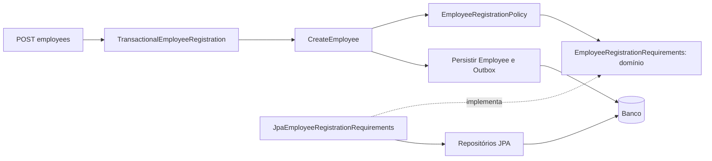

# 008 — Serviço de domínio para admissão de empregados

Estado: aprovado pelo responsável técnico e integrado à main pelo PR #6. Data: 28/10/2026.

## Contexto e decisão

CreateEmployee verificava departamento existente, cargo existente e disponibilidade do e-mail diretamente pelos repositórios da aplicação. O enunciado exige serviços de domínio; após discutir responsabilidades, o responsável técnico solicitou: “Crie as regras numa classe de serviço de dominio”.

EmployeeRegistrationPolicy passa a aplicar essas três condições. São regras de admissão que dependem de outros registros, além dos valores e transições internos a Employee. A classe é Java comum, independente de Spring, JPA, Kafka e HTTP, e não persiste objetos nem controla transações.

A alternativa de manter os checks no serviço de aplicação é funcionalmente válida e mais simples. A extração escolhida explicita a política de negócio e permite testá-la separadamente, ao custo de três classes adicionais: política, porta e adaptador. Não foram inventadas condições novas para justificar a classe.

## Divisão de responsabilidades

| Componente | Responsabilidade |
|---|---|
| Employee e Email | Validade dos próprios valores, identidade e transições do empregado. |
| EmployeeRegistrationPolicy | Decidir se as condições externas de admissão foram atendidas. |
| EmployeeRegistrationRequirements | Porta do domínio: consultar existência de departamento/cargo e disponibilidade do e-mail. |
| JpaEmployeeRegistrationRequirements | Responder às consultas com os repositórios Spring Data JPA existentes. |
| CreateEmployee | Coordenar construção/validação, política, persistência e registro na Outbox. |
| TransactionalEmployeeRegistration | Aplicar a transação do cadastro inteiro. |
| EmployeeExceptionHandler | Traduzir as razões de negócio para o contrato HTTP. |
| Constraints do banco | Garantir unicidade e referências sob concorrência. |

O domínio define as informações de que precisa. A infraestrutura implementa esse contrato; a política não conhece entidades JPA. A revisão posterior da decisão 009 também remove Page/Pageable dos contratos da aplicação.

A dependência é fornecida pelo construtor. ApplicationConfig cria EmployeeRegistrationPolicy com @Bean; a política não recebe @Service. A classificação como serviço de domínio vem da responsabilidade de negócio, não de uma anotação do Spring.

## Regras e fluxo preservados

1. CreateEmployee constrói Email e Employee, preservando as validações de valores anteriores ao acesso aos dados.
2. policy.validate(email, departmentId, positionId) consulta e valida departamento, cargo e e-mail, nessa ordem.
3. Departamento inexistente produz DEPARTMENT_NOT_FOUND e interrompe as demais consultas.
4. Cargo inexistente produz POSITION_NOT_FOUND e interrompe a consulta de e-mail.
5. E-mail indisponível produz EMAIL_ALREADY_EXISTS, incluindo o caso de empregado inativo.
6. Se a política aceitar, o caso de uso salva o empregado e acrescenta EmployeeCreatedEvent na Outbox.
7. O commit confirma os dois registros; uma falha mantém o rollback já existente.

EmployeeRegistrationException foi movida da aplicação para domain.employee, junto com suas razões. Não contém códigos HTTP nem dependências técnicas. A API mantém 422 para referências inexistentes, 409 para e-mail duplicado e 400 para valores inválidos; nomes dos códigos e mensagens existentes foram preservados.

As consultas de admissão foram retiradas das interfaces EmployeeRepository, DepartmentRepository e PositionRepository da aplicação e de seus adaptadores antigos, pois perderam os consumidores. Os repositórios JPA mantêm as consultas utilizadas pelo novo adaptador. Os demais métodos de persistência, busca e paginação continuam nas portas existentes.

## Concorrência e limites

A política observa os fatos disponíveis durante as consultas; não reserva e-mail nem impede alterações entre consulta e gravação. Duas requisições podem receber a indicação de e-mail disponível. A constraint uk_employees_email decide qual gravação é permitida; a outra transação falha e não confirma empregado nem evento.

Chaves estrangeiras também permanecem necessárias: a consulta prévia de existência não substitui a integridade referencial. O serviço oferece uma decisão de negócio compreensível, sem prometer garantia global de unicidade.

A política é sem estado mutável por requisição; suas consultas podem depender do banco por meio da porta. “Independente de frameworks” não significa que o resultado seja independente do estado externo.

O modelo de identidade de Department e Position é revisado na decisão 009, com classes finais e igualdade por ID. A extração da política não alterou as regras desses cadastros, o esquema, os contratos Kafka ou a lógica da Outbox.

## Arquivos alterados

| Grupo | Arquivos |
|---|---|
| Novos no domínio | EmployeeRegistrationPolicy, EmployeeRegistrationRequirements |
| Movido para domínio | EmployeeRegistrationException, antes em application |
| Novo adaptador | JpaEmployeeRegistrationRequirements |
| Coordenação e configuração | CreateEmployee, ApplicationConfig |
| Portas da aplicação | EmployeeRepository, DepartmentRepository, PositionRepository |
| Adaptadores com consultas removidas | EmployeePersistenceAdapter, DepartmentPersistenceAdapter, PositionPersistenceAdapter |
| HTTP | EmployeeExceptionHandler, apenas import da exceção |
| Testes | EmployeeRegistrationPolicyTest, CreateEmployeeTest, EmployeeApiIntegrationTest |
| Documentação | README, AI_USAGE, domínio, casos de uso e decisões 002, 007 e 008 |

## Verificação

O build limpo com H2 e Kafka real executou 65 testes, sem falhas, erros ou ignorados, e gerou o jar executável. A inspeção do jar confirmou política, porta e exceção no domínio, sem a classe antiga da exceção na aplicação.

A suíte com PostgreSQL 16.15 e Kafka real também executou 65 testes sem falhas, erros ou ignorados, usando a base exclusiva gestao_outbox_tests_20261027_01. Não houve alteração de esquema.

Os quatro testes da política verificam admissão válida, prioridade de rejeição por departamento/cargo e e-mail indisponível. Os cinco testes do caso de uso verificam delegação com e-mail normalizado, ordem política → persistência → Outbox, rejeição sem escrita, validação de e-mail antes da política e propagação de falhas de persistência/Outbox.

A integração HTTP verifica os códigos de referência inexistente, duplicidade inclusive entre inativos e cadastro concorrente. A suíte de eventos existente continua cobrindo publicação/consumo dos dois contratos, rollback e deduplicação. Cobertura percentual ainda não foi medida; Testcontainers continua adiado por decisão do responsável técnico.
