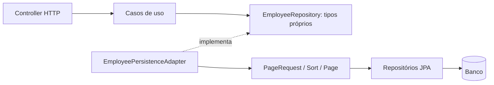

# 009 — Paginação própria e identidade das entidades

Estado: aprovado pelo responsável técnico e integrado à main no PR #7. Data: 28/10/2026.

## Contexto e decisões

O domínio já era independente de frameworks. A aplicação ainda expunha Page/Pageable do Spring Data e construía PageRequest/Sort. Department e Position eram records com igualdade por todos os componentes, em contraste com a identidade por ID de Employee.

O responsável técnico solicitou remover o acoplamento de paginação do núcleo e identificar Department/Position pelo ID. A revisão preserva contratos HTTP, validações, ordenação e esquema do banco.

## Paginação

EmployeePagination passa a ser um record Java com page e size. O construtor valida página não negativa, tamanho entre 1 e 100 e deslocamento até Integer.MAX_VALUE. O factory create continua disponível e delega ao mesmo construtor; instanciar o record diretamente também aplica as validações.

PageResult<T> representa content, page, size e totalElements. A lista é copiada com List.copyOf, protegendo sua composição contra alteração externa; isso não faz uma cópia profunda das entidades que ela contém. O construtor valida metadados e tamanho do conteúdo.

totalPages é calculado com divisão e resto em long, evitando overflow de uma soma do tipo total + size - 1. O retorno continua int, limitado a Integer.MAX_VALUE, preservando o tipo do contrato anterior. Uma consulta sem resultados tem totalPages=0. Uma página além da última é válida e retorna conteúdo vazio com os metadados da consulta.

ListEmployees, SearchEmployeesByDepartment e EmployeeRepository usam apenas esses tipos próprios. O contrato do repositório declara a ordenação createdAt ASC, id ASC. EmployeePersistenceAdapter converte a solicitação para PageRequest/Sort, consulta o repositório JPA e converte o Page resultante para PageResult.

O DTO HTTP continua expondo exatamente content, page, size, totalElements e totalPages. EmployeeController não importa Spring Data; ele traduz o resultado da aplicação para os DTOs HTTP existentes.

O Spring Data continua sendo usado pela infraestrutura, inclusive no polling da Outbox. A revisão não tenta substituí-lo nessa camada. O domínio e a aplicação não importam Spring, JPA ou classes da infraestrutura/interfaces.

### Alternativas e custo

Manter Page/Pageable na aplicação era a escolha pragmática inicial, aceita na decisão 003. Os tipos próprios acrescentam conversão e manutenção do cálculo dos metadados, mas permitem substituir o mecanismo de persistência sem mudar esses contratos da aplicação.

Não foi criado um framework próprio de ordenação: o contrato atual tem uma ordem fixa, implementada pelo adaptador. Se surgir ordenação configurável, ela deverá ser modelada e traduzida explicitamente.

Paginação por cursor permanece fora deste incremento. Custo da contagem, deslocamentos e movimentação de registros entre requisições permanecem os mesmos; independência de framework não elimina essas características das consultas.

## Identidade de Department e Position

Department e Position passam a ser classes finais, com campos privados finais, os mesmos construtores/acessores e as validações anteriores. equals/hashCode consideram apenas o ID, dentro do próprio tipo, em coerência com Employee.

Consequências:

- Mesmo ID e atributos descritivos diferentes representam a mesma entidade.
- IDs diferentes com atributos iguais representam entidades diferentes.
- Department e Position com o mesmo UUID não são iguais entre si.
- O hashCode é consistente com equals, permitindo uso correto em HashSet e HashMap.
- A igualdade não atualiza os dados de uma instância nem cria novos casos de uso de edição.
- Email e CostCenterCode continuam records/objetos de valor, comparados por valor.

Seria possível manter records e sobrescrever equals/hashCode. Foram escolhidas classes finais para comunicar a mesma semântica de entidade usada em Employee, ao custo de acessores e igualdade explícitos.

Os DTOs HTTP de departamento/cargo já eram separados do domínio. Continuam records, mantendo campos, códigos 201/400 e Location. Os modelos JPA e suas tabelas não precisaram mudar.

## Arquivos envolvidos

| Grupo | Arquivos criados/modificados |
|---|---|
| Contratos de consulta | EmployeePagination, PageResult, EmployeeRepository |
| Casos de uso | ListEmployees, SearchEmployeesByDepartment |
| Conversão da persistência | EmployeePersistenceAdapter |
| HTTP | EmployeeController |
| Entidades de domínio | Department, Position |
| Testes de aplicação | EmployeePaginationTest, PageResultTest, ListEmployeesTest, SearchEmployeesByDepartmentTest |
| Testes de identidade | OrganizationEntityIdentityTest |
| Integração HTTP | EmployeeListApiIntegrationTest, EmployeeDepartmentSearchIntegrationTest, OrganizationApiIntegrationTest |
| Documentação | README, AI_USAGE, domínio, casos de uso e decisões 003, 004, 008 e 009 |

## Verificação

- Compilação direta de todos os fontes de domain e application com javac --release 21 e classpath inicialmente vazio: sucesso, 29 classes geradas sem bibliotecas externas. O diretório de classes temporário foi criado com mktemp para não reutilizar artefatos de builds anteriores.
- Build limpo clean verify com H2 e Kafka real: 74 testes, sem falhas, erros ou ignorados; jar executável gerado.
- Suíte PostgreSQL 16.15 e Kafka real em gestao_outbox_tests_20261027_01: 74 testes, sem falhas, erros ou ignorados.
- Testes de identidade cobrem o mesmo ID com valores diferentes, IDs diferentes com valores iguais, simetria, hashCode, tipos diferentes e deduplicação em HashSet.
- Testes de paginação cobrem limites de construção direta, total vazio/exato/parcial, contagem extrema sem overflow, cópia imutável da lista, metadados inválidos e página além da última.
- Integração HTTP mantém filtros, SQL parametrizado, ordenação e desempate, paginação, campos/totalizadores e JSONs de departamentos/cargos.
- A suíte de eventos existente permanece cobrindo Outbox, rollback, publicação e consumo dos dois contratos Kafka, inclusive duplicatas e consumo em ordem inversa.
- Não houve alteração de migração/esquema. Cobertura e Testcontainers foram acrescentados posteriormente, nas decisões [010](010-cobertura-e-caminhos-criticos.md) e [014](014-testcontainers.md).
